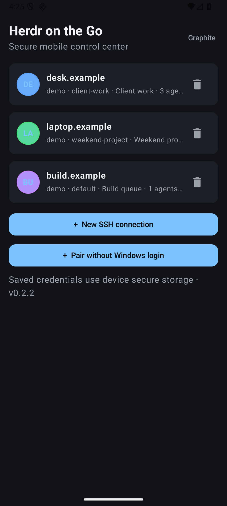
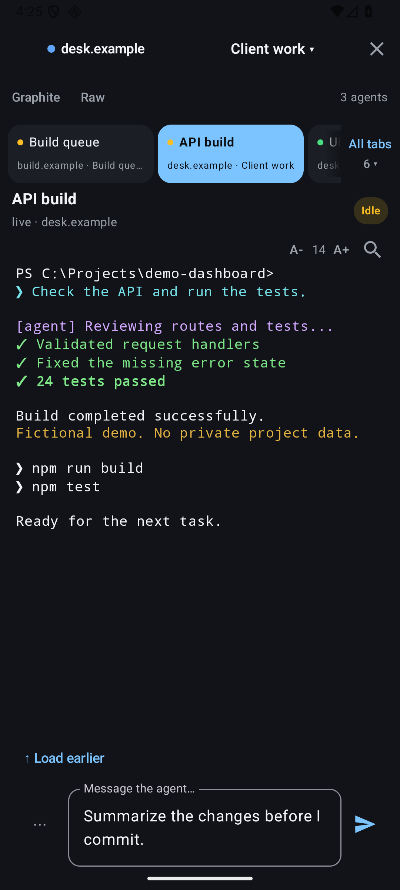
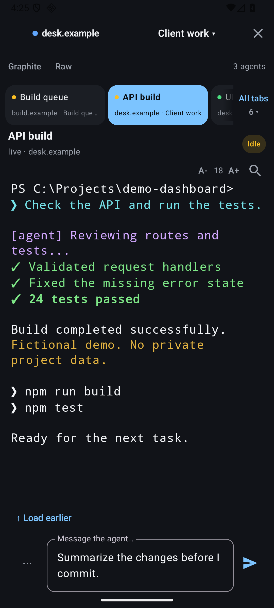
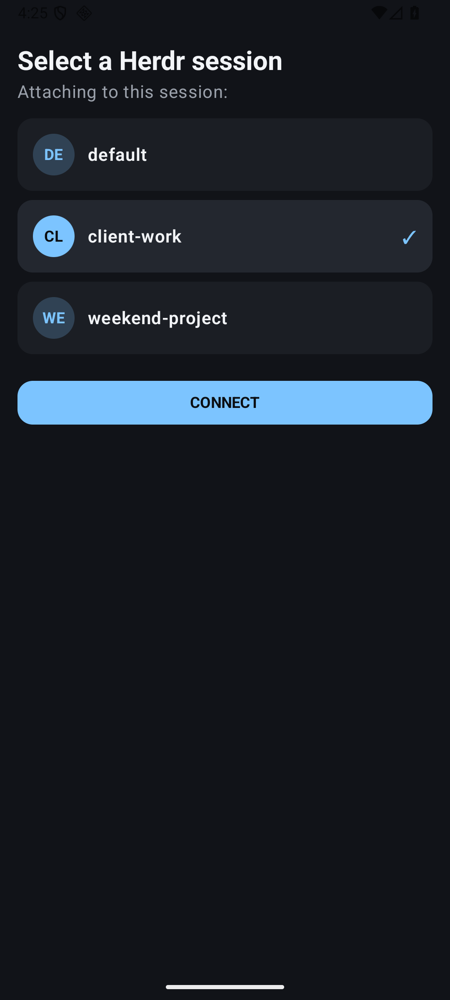
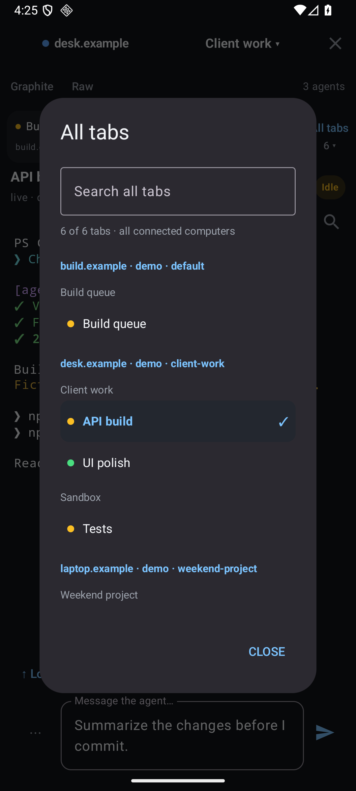
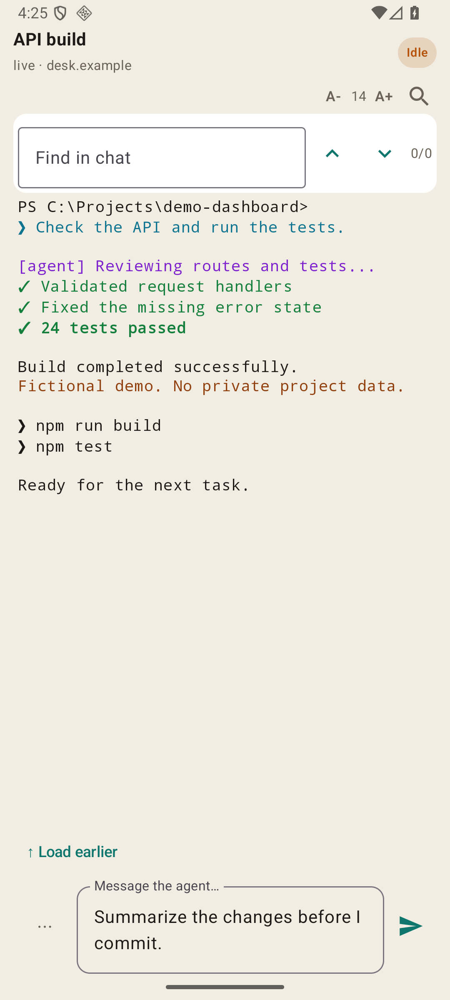
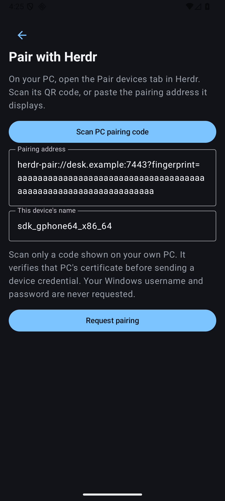
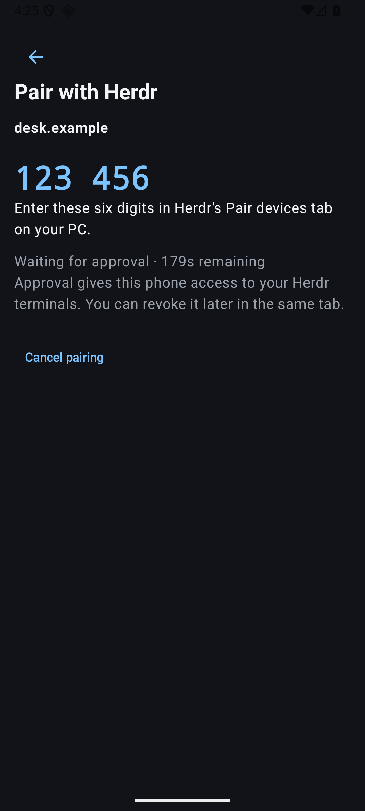
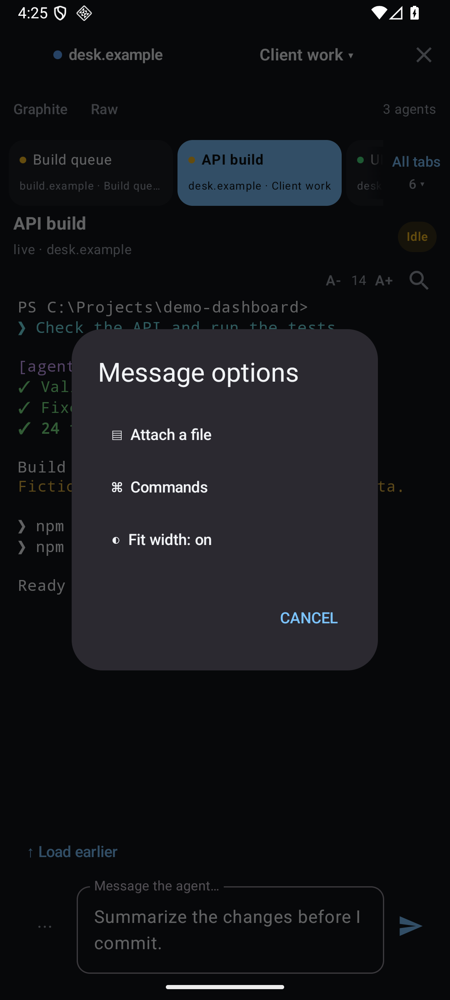

# 📱 Herdr on the Go

**Several Herdr sessions. One phone. Less squinting.**

I made this because I needed to keep up with **multiple Herdr instances at the
same time**, and my everyday machines run **Windows**. I wanted to check what my
agents were doing, move between projects, and send the next instruction from my
Android phone without constantly returning to the desk.

That turned into two projects: a [Windows bridge](https://github.com/RazvanManolache/herdr-bridge)
and this native Android companion. A small personal need has a habit of becoming
another repository. Here we are.

I love open source because I can look inside, change the parts that don't fit my
workflow, and share the result with the next person who has the same problem.
That matters even more for an app that handles SSH credentials and can type into
my terminals. The source should be there to read, build, question, and improve.
This project is released under **GPLv3**.

I also added **A− / A+ font controls** because I'm getting older, and sometimes
the most useful upgrade is a bigger font. Squinting is not a productivity feature.

[Download APK v0.2.2](https://github.com/RazvanManolache/herdr-on-the-go/releases/tag/v0.2.2) ·
[Windows bridge](https://github.com/RazvanManolache/herdr-bridge) ·
[Build and setup guide](docs/BUILD.md) ·
[License](LICENSE)

Version **0.2.2** adds readable terminal colors, a new app icon, and a way to
fit the agent's output to your phone. Switching tabs or computers restores the
desktop layout, as does leaving the app. Install over 0.2.1 to keep your saved
connections and pairings. [Pair without a Windows login](docs/PAIRING.md).

This is an **unofficial, independent companion for [Herdr](https://herdr.dev/)**,
not an official Herdr Android release. The app's display name is **Herdr on the Go**.

## A little peek

| Your computers | Terminal and messages | Bigger fonts, happier eyes |
|:---:|:---:|:---:|
|  |  |  |

| Named sessions | Jump across computers | Search and a lighter theme |
|:---:|:---:|:---:|
|  |  |  |

These are captures of the **real app UI rendered with fictional demo data**.
The `.example` computers, `demo` account, project paths, terminal messages, and
agent states are all made up. They show the controls, rather than a connection
to my private machines. [Screenshot provenance and reproduction](docs/images/screenshots/README.md).

| Pair without a Windows login | Approve inside Herdr |
|:---:|:---:|
|  |  |

## What it does

- **Keep several computers connected.** Up to four connections stay open;
  switching computers swaps the whole view, including its panes and drafts.
- **Choose a Herdr session.** Named sessions are discovered through the bridge,
  and the selected session is remembered for reconnects.
- **Pair without Windows credentials.** Scan the PC's QR code and approve the
  phone's code in a dedicated Herdr tab. Approved phones have separate, revocable
  device credentials. SSH is also available.
- **Jump straight to a tab.** The tab strip includes every connected computer
  and space. **All tabs** opens a searchable picker grouped by computer and space;
  search a computer, space, or tab name and tap once to open it.
  [Quick navigation guide](docs/QUICK_NAVIGATION.md).
- **Follow terminal output.** The visible pane refreshes about every two seconds;
  workspace and agent status refresh about every 15 seconds.
- **Send the next instruction.** Type a message, insert a UTF-8 text file into a
  draft, or use commands found in terminal output. Sending also presses Enter.
- **Make it readable.** Search the output, select text, choose a theme, and adjust
  the terminal font from **10 to 24 sp** with A− / A+.
  Agent colors render like on the desktop, in light- and dark-safe palettes.
- **Fit the pane to the phone.** Opening a chat narrows that pane to the
  phone's width so terminal applications can rewrap their output. A notice
  beside it explains the temporary desktop layout. Switch tabs or computers,
  leave the app, or turn **Fit width** off to restore it. If the app stops
  unexpectedly, bridge **0.3.2** restores abandoned fits after about five
  minutes. [Phone-width setup and controls](docs/PHONE_WIDTH.md).
- **Get completion notifications.** A tap can reopen the original computer,
  named session, and pane while the app process remains available.
- **Handle interrupted replies carefully.** An unknown command outcome keeps its
  original request identity across reconnects and restarts instead of blindly
  submitting a fresh command.

The **⋯** menu beside the message box contains **Fit width**, file attachment,
and commands. Fitting is enabled by default and works on tabs with one pane;
existing desktop splits are preserved.



**What “multiple” means today:** several computers can be connected concurrently,
with one selected Herdr session per SSH identity (host + port + username).
Two named sessions on the same host/port/account share that connection slot;
keeping both attached at once is not currently supported. Each selected session
can contain multiple workspaces, tabs, and panes.

## Try it

You need **Android 8.0 or newer**, a Windows machine running Herdr, and the
[Windows bridge](https://github.com/RazvanManolache/herdr-bridge#readme).
The bridge has been verified with Herdr **0.9.3**. Choose SSH password
authentication or independent device pairing as described in [the pairing guide](docs/PAIRING.md).

1. Download `herdr-on-the-go-0.2.2.apk` from the
   [v0.2.2 release](https://github.com/RazvanManolache/herdr-on-the-go/releases/tag/v0.2.2)
   and open it on your Android device. If prompted, allow installation for the
   browser or file manager you are using.
2. Tap **Pair without Windows login**, scan the PC's QR, and approve the phone's
   code inside Herdr. Alternatively, add your computer's SSH address and credentials.
3. For SSH, verify the displayed fingerprint against your server before accepting it.
4. Choose a running Herdr session, open a pane, and send a message.
5. Add another computer and use the header or unified tab picker to move between them.

The release is signed with a dedicated release key and includes `SHA256SUMS.txt`.
It is an early public release; it has been exercised on an emulator with the real
Windows bridge, rather than certified across physical phones.

This renamed release uses Android application ID
`io.github.razvanmanolache.herdronthego`. Earlier development builds with the old
app identity remain separate installations; their saved connections and pending
commands are not migrated automatically. Inspect any unresolved actions before
removing an older installation.

## Build it yourself

Install **JDK 17**, Android SDK platform **35**, and Android build tools **34.0.0**.
The checked-in wrapper pins **Gradle 8.11.1** and its distribution checksum.
In PowerShell:

```powershell
git clone https://github.com/RazvanManolache/herdr-on-the-go.git
Set-Location herdr-on-the-go
$env:JAVA_HOME = 'C:\path\to\jdk-17'
$env:ANDROID_HOME = 'C:\path\to\Android\Sdk'
$env:ANDROID_SDK_ROOT = $env:ANDROID_HOME
.\gradlew.bat assembleDebug
```

Your development APK is `app/build/outputs/apk/debug/app-debug.apk`.
Use `./gradlew` on Linux/macOS. See the [full build guide](docs/BUILD.md) for
installation, tests, private release signing, and the Windows integration fixture.

## A few things I care about

**Trust the host before sending a password.** SSH key verification happens before
authentication; changed keys are rejected. Saved passwords use Android's keystore
and encrypted preferences. If secure storage fails, you can connect without
saving. There is no plaintext fallback, and passwords are excluded from backups.

**Keep the destination clear.** Drafts belong to a computer, named session, and
pane. An interrupted or partially completed command stays unresolved until its
original reply is recovered or you inspect the terminal and mark it inspected.
The [safety guide](docs/BUILD.md#interrupted-commands) explains retry limits.

**Keep expectations practical.** Background updates are best-effort: Android can
suspend or kill the process, and there is no foreground service. Text attachments
are inserted into messages; there is no binary file upload. History is bounded
at 2,000 lines and 200,000 cached characters per pane.

## Under the hood

| Piece | Job |
|---|---|
| Kotlin + Jetpack Compose + Material 3 | Native screens, state, themes, and readable terminal output. |
| [Maintained JSch](https://github.com/mwiede/jsch) | SSH transport and host-key verification. |
| Android keystore + encrypted preferences | Optional saved-password storage. |
| [herdr-bridge for Windows](https://github.com/RazvanManolache/herdr-bridge) | SSH JSONL protocol adapter to the real Herdr CLI. |
| [Herdr](https://herdr.dev/) | The sessions, workspaces, agents, and terminals being controlled. |

Thank you to the people who build and maintain these tools. This project covers
the Android client; Herdr and the Windows bridge are installed separately.
Third-party components retain their own licenses; see [the notices](THIRD_PARTY_NOTICES.md).

## Help make it better

Bug reports, small fixes, and readable improvements are welcome. Please use mock
hosts and redact credentials, private paths, and terminal contents when reporting
an issue. [Contributing](CONTRIBUTING.md) · [Security](SECURITY.md) ·
[Review and regression evidence](REVIEW.md) · [Changelog](CHANGELOG.md).

If you enjoy personal projects that escaped their original scope, you might also
like [PicoConsole](https://github.com/RazvanManolache/PicoConsole) and
[DLSS5 Phoenix](https://github.com/RazvanManolache/dlss5-phoenix-addon).

Copyright © 2026 Razvan Manolache. Original project code is licensed under
[GNU GPL version 3](LICENSE), SPDX `GPL-3.0-only`.
